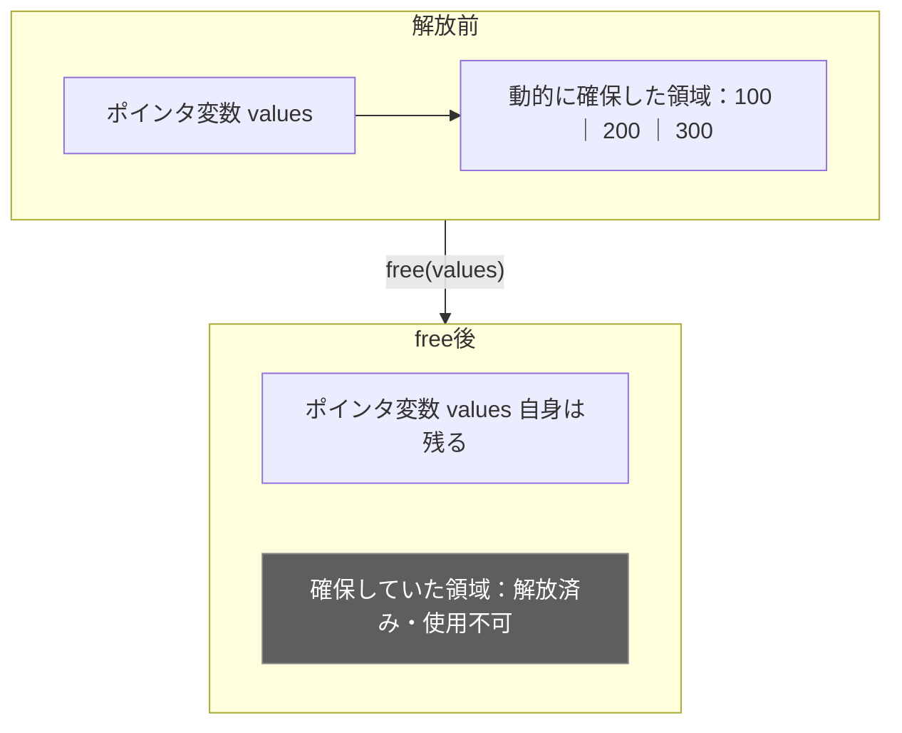
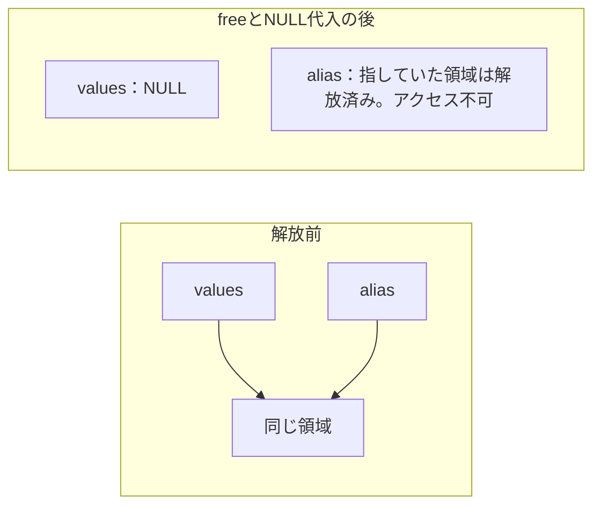

# 【C言語の壁を越えよう！#18】freeとは？メモリ解放のしくみと注意点

〜メモリの世界から理解するC言語〜

YouTube：未公開（公開後にリンクを追加します）

## この回で学ぶこと

- freeが解放するのは、ポインタ変数ではなく指し先の領域であること
- 解放後のアクセスと未定義動作
- 二重解放と、freeへ渡してはいけないアドレス
- NULLを代入する意味と、free(NULL)の動作
- 解放を忘れると起こるメモリリーク

## ファイル構成

```text
18_free/
├── README.md
└── free_basic.c
```

このサンプルは標準ライブラリだけを使用します。`mdump.c`とのリンクは不要です。

## サンプルコード

ファイル：`free_basic.c`

```c
#include <stdio.h>
#include <stdlib.h>

int main(void)
{
    const size_t count = 3;
    int *values = malloc(count * sizeof *values);

    if (values == NULL) {
        fprintf(stderr, "malloc failed.\n");
        return 1;
    }

    for (size_t i = 0; i < count; i++) {
        values[i] = (int)(i + 1) * 100;
    }

    printf("before free: %d %d %d\n",
           values[0], values[1], values[2]);

    free(values);
    values = NULL;

    if (values == NULL) {
        puts("values is NULL: do not access the array.");
    }

    free(values);
    puts("free(NULL) completed.");

    return 0;
}
```

前半では整数3個分の領域を確保し、100、200、300を代入して表示します。後半では領域を解放し、ポインタ変数にNULLを設定します。最後の`free(values)`は、`free(NULL)`が何もしないことを確認するための呼び出しです。通常、解放を済ませるために、この最後の呼び出しを追加する必要はありません。

## コンパイルと実行

リポジトリのルートから移動：

```sh
cd samples/18_free
```

コンパイル：

```sh
clang -std=c17 -O0 -Wall -Wextra -Wpedantic free_basic.c -o free_basic
```

実行（別のコマンド）：

```sh
./free_basic
```

## 実行結果（実測）

```text
before free: 100 200 300
values is NULL: do not access the array.
free(NULL) completed.
```

macOS（arm64）、Apple clang 21.0.0でコンパイル・実行した出力です。上記の警告オプションで警告なし、終了コード0を確認しています。

## freeが解放するのは、指し先の領域

`free(values)`は、mallocなどで確保した領域を解放します。ポインタ変数`values`そのものをなくす操作ではありません。解放した領域は、後のメモリ確保で再利用できるようになります。



解放した領域を、自分の配列として読み書きし続けてはいけません。また、freeは中身をゼロにする操作ではありません。ゼロ埋めとメモリ解放は、役割が異なります。

## 注意点①：解放した領域を使わない

**❌ 誤った例：説明用です。実行するサンプルには含めていません。**

以下は、`values`が確保済みの有効な領域を指しているところから始める例です。

```c
free(values);

/* 解放後に読み出してはいけない */
printf("%d\n", values[0]);
```

解放済みの領域を使ってしまう誤りを、 **Use After Free（ユース・アフター・フリー）** と呼びます。読み出しだけでなく、書き込みも禁止です。

プログラムの不具合になるだけでなく、情報漏えいや不正なコードの実行など、深刻なセキュリティ脆弱性につながることもあります。[MITRE CWE-416](https://cwe.mitre.org/data/definitions/416.html)

### 未定義動作とは？

未定義動作とは、その操作を行った場合にプログラムがどう動くかを、C言語の規格が保証しないことです。

- 異常終了することがある
- 予想外の結果になることがある
- 正常に動いたように見えることもある

必ずコンパイルエラーや実行時エラーになるとは限りません。最適化設定などによって動作が変わることもあり、一度期待した結果が出ても、正しいとは判断できません。

### メモリダンプも解放前に行う

メモリダンプも、指定した領域の各バイトを読み出す処理です。確認のためであっても、解放後の領域を読み出すと未定義動作になります。そのため、メモリダンプは解放前に行います。

## 注意点②：同じ領域を二度解放しない

**❌ 誤った例：説明用です。実行するサンプルには含めていません。**

```c
free(values);

/* 同じ領域をもう一度解放してはいけない */
free(values);
```

同じ領域を二度解放することを、 **Double Free（二重解放）** と呼びます。これも未定義動作です。

呼び出した関数の中と呼び出し元の両方で解放してしまう、といったことが起こらないように、誰が、いつ解放するかを決めておきます。

## 注意点③：どんなアドレスでもfreeできるわけではない

以下の例は、それぞれ独立した説明用のコードです。

**❌ 普通のローカル配列をfreeする**

```c
int local_values[3];
free(local_values);
```

普通のローカル配列は、freeで解放する対象ではありません。

**❌ 確保した領域の途中をfreeする**

```c
/* valuesはmallocで確保した3要素分の領域の先頭を指す */
free(values + 1);
```

途中の要素を指すアドレスを渡してはいけません。今回の場合、mallocから受け取った先頭のアドレスを渡します。

**正しい呼び出し（領域がまだ解放されていない場合）：**

```c
free(values);
```

確保した領域全体をまとめて解放します。配列の要素を1個ずつfreeするわけではありません。

## なぜ、解放後にNULLを代入する？

```c
free(values);
values = NULL;
```

この2行では、確保した領域を解放し、ポインタ変数にNULLを設定しています。

- `free(values)`：確保した領域を解放する
- `values = NULL`：ポインタ変数にNULLを設定し、有効な領域を指していない状態にする

freeを呼んでも、変数が自動的にNULLになるわけではありません。解放後にNULLを設定すると、その後の処理でNULLかどうかを確認できます。

今回のサンプルでも、NULLかどうかを確認して、配列へアクセスしないことをメッセージで示しています。NULLを設定するだけですべての誤使用を防げるわけではなく、NULLの指し先を読み書きしてはいけません。

## free(NULL)は何もしない

```c
free(values);
values = NULL;

free(values);  /* free(NULL)なので何もしない */
```

C言語の標準規格では、freeにヌルポインタを渡した場合は「何も行わない（no action occurs）」と明確に定められています。たまたま問題なく動いたのではなく、規格で保証された動作です。[WG14 N1570：7.22.3.3](https://www.open-std.org/jtc1/sc22/wg14/www/docs/n1570.pdf)

上の最後の呼び出しは、同じ領域を二度解放する操作ではありません。ただし、NULLでなければ必ず安全にfreeできる、という意味ではありません。

## 同じ領域を指す別のポインタにも注意

確保に成功した後の例：

```c
int *alias = values;

free(values);
values = NULL;

/* aliasからも、解放済みの領域は使えない */
```



`values`へNULLを代入しても、`alias`が自動的にNULLになるわけではありません。同じ領域を指していたすべてのポインタについて、解放後にその領域を使わないようにする必要があります。

## 解放を忘れると起こるメモリリーク

**❌ 誤った例：説明用です。実行するサンプルには含めていません。**

```c
int *values = malloc(3 * sizeof *values);

/* freeせず、アドレスを失ってしまう */
values = NULL;
```

確保に成功していた場合、NULLを代入しても領域は解放されません。ほかにアドレスを保持していなければ、その領域にアクセスすることも、freeで解放することもできなくなります。

こうした問題を、**メモリリーク**と呼びます。長く動くプログラムで繰り返し起こると、不要なメモリを抱え続け、必要なメモリを確保できなくなる原因になります。

**NULLの代入は、freeの代わりにはなりません。**

## まとめ

- freeは、動的に確保した領域を解放する
- 解放した領域を読み書きしない
- 同じ領域を二度解放しない
- NULLの代入だけでは領域は解放されない
- 誰が、いつ解放するかを決めておく

確保する、初期化する、使う、そして解放する。この一連の流れを意識しましょう。

## シリーズ

- [第16回 スタックとヒープの違い](../16_stack_heap/)（[公開動画](https://youtu.be/OvsssrBBGe0)）
- [第17回 mallocで配列を確保！初期化はどうする？](../17_malloc/)（[公開動画](https://youtu.be/sdjV4kH4nL8)）
- 第18回 本ページ（動画未公開）
- [シリーズ一覧](../../README.md)

## 参考資料

- [WG14 N1570：C11委員会草案](https://www.open-std.org/jtc1/sc22/wg14/www/docs/n1570.pdf)（3.4.3：未定義動作、6.2.4：オブジェクトの寿命、7.22.3.3：free）
- [MITRE CWE-416：Use After Free](https://cwe.mitre.org/data/definitions/416.html)
- [SEI CERT C：MEM34-C. Only free memory allocated dynamically](https://cmu-sei.github.io/secure-coding-standards/sei-cert-c-coding-standard/rules/memory-management-mem/mem34-c/)
