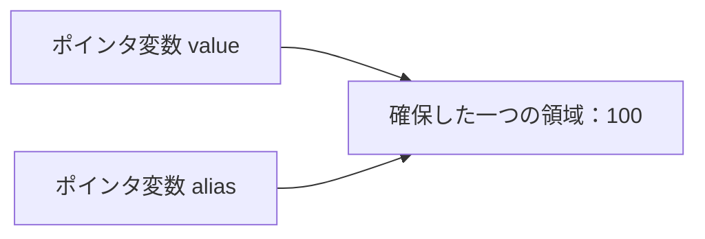
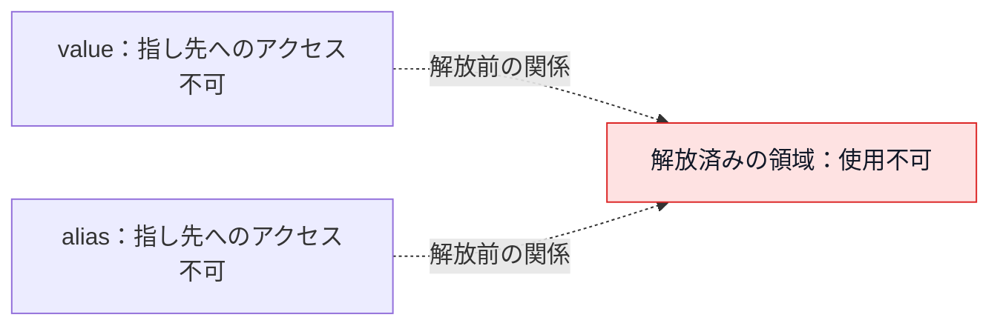
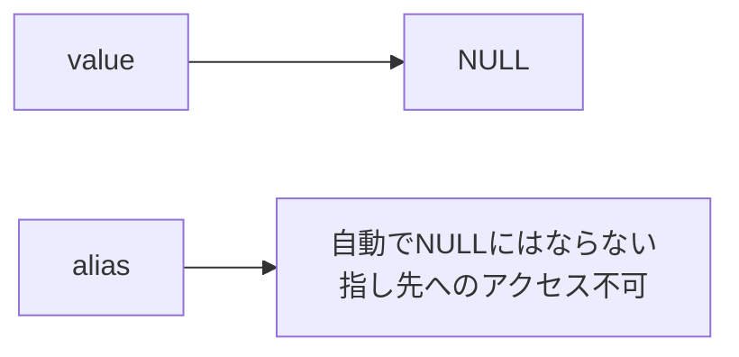

# 【C言語の壁を越えよう！#19】ダングリングポインタとは？NULLにしても残る危険

〜メモリの世界から理解するC言語〜

YouTube：[ダングリングポインタとは？NULLにしても残る危険](https://youtu.be/gPHBpsI33GQ)

## この回で学ぶこと

- ダングリングポインタの意味
- 同じ領域を指す複数のポインタ
- NULL代入で防げることと、その限界
- ローカル変数の寿命との関係
- 誰が解放し、いつまで使うかを決めること

## ダングリングポインタとは？

英語では **dangling pointer** と書きます。**dangling** は「ぶら下がっている」「宙ぶらりんになっている」という意味です。

寿命が終わったオブジェクトを指していたポインタを、ダングリングポインタと呼びます。指し先の寿命が終わり、ポインタだけが宙ぶらりんになっている、と考えるとイメージしやすくなります。

ポインタ変数が残っていても、その指し先を使ってよいとは限りません。

## ファイル構成

```text
19_dangling_pointer/
├── README.md
└── dangling_pointer.c
```

標準ライブラリだけを使用します。`mdump.c`とのリンクは不要です。解放後の領域へのメモリダンプは行いません。

## サンプルプログラム全体

ファイル：`dangling_pointer.c`

```c
#include <stdio.h>
#include <stdlib.h>

int main(void)
{
    int *value = malloc(sizeof *value);
    if (value == NULL) {
        return 1;
    }
    *value = 100;
    int *alias = value;

    printf("value: %d\n", *value);
    printf("alias: %d\n", *alias);

    free(value);
    value = NULL;
    alias = NULL;

    puts("released; both pointers set to NULL");
    return 0;
}
```

整数一つ分の領域を確保し、100を代入します。そのアドレスを別のポインタ`alias`にも保存し、解放前に両方から値を読み出します。解放した後は、指し先もポインタの以前の値も読み出しません。

確保に失敗した場合は、終了コード1で終了します。

## コンパイルと実行

リポジトリのルートから移動：

```sh
cd samples/19_dangling_pointer
```

コンパイル：

```sh
clang -std=c17 -O0 -Wall -Wextra -Wpedantic dangling_pointer.c -o dangling_pointer
```

実行：

```sh
./dangling_pointer
```

## 実行結果

macOS（arm64）、Apple clang 21.0.0で上記オプションを使用し、警告なしでコンパイル・実行して確認した結果です。

```text
value: 100
alias: 100
released; both pointers set to NULL
```

最後の行は、解放とNULL代入を終えたことを知らせる固定メッセージです。解放した領域の中身を表示した結果ではありません。

## コピーしたのはアドレス

```c
int *alias = value;
```

`alias`は「別名」という意味です。この代入では、整数の100ではなく、その整数を指すポインタ値をコピーしています。新しい領域を確保する処理ではありません。



ポインタ変数は二つありますが、確保した領域は一つです。

## freeすると両方の指し先を使えなくなる

```c
free(value);
```

`free`で解放されるのは、指し先の領域です。`alias`も同じ領域を指していたので、`alias`からその整数を読み書きすることもできなくなります。



点線は、解放前の関係を示しています。現在有効なアドレスを表した図ではありません。C言語では、指し先の寿命が終わると、そのポインタの値は不定になります。「以前のアドレスが、使える値として残っている」と考えてはいけません。

## 一つをNULLにしても、別のポインタは変わらない

```c
value = NULL;
```

書き換わるのは`value`だけです。`alias`は別の変数なので、自動的にNULLにはなりません。



### NULLチェックでは指し先の寿命を確認できない

**❌ 誤った例：説明用です。実行するサンプルには含めていません。**

確保・初期化に成功して`alias = value`とし、その後`free(value); value = NULL;`を行った状態を想定します。

```c
if (alias != NULL) {
    printf("%d\n", *alias);
}
```

NULLとの比較は、指し先が生きているかを調べる機能ではありません。この状態の`alias`は、不定になった値を比較やアドレス表示のために読み出すべきではありません。

解放済みの領域を読み書きすると未定義動作です。C言語の規格が動作を保証しないため、一度期待した値が表示されても正しいコードとは言えません。

## NULL代入は必須ではない

```c
free(value);
value = NULL;
alias = NULL;
```

解放した後、`value`と`alias`のそれぞれにNULLを代入します。`value`にNULLを代入しても、`alias`は自動では変わらないため、別々に代入します。

ただし、**freeの後に必ずNULLを代入しなければならない、というルールではありません。**

今回のサンプルでは、この後二つのポインタを使わずに`main`を終了します。`main`を抜けると、ローカル変数であるポインタ自身の寿命も終わります。そのため、この二つのNULL代入を省いても問題ありません。ここでは、別々のポインタにNULLを設定する方法を示しています。

その後も処理が続く場合には、NULLの代入が、解放済みの指し先を誤って再利用するのを防ぐ助けになります。NULLチェックをしてから使うなど、その後の処理と組み合わせます。NULLを代入しても、別の場所に保存されたポインタまで自動で変わるわけではありません。

NULLを代入したポインタも、そのまま`*value`のように読み出してよいわけではありません。NULLは、使える指し先がないことを表す値です。

### freeは一つの領域につき一度

`alias`にNULLを代入する前に`free(alias)`を呼ぶと、同じ領域の二重解放になります。NULLを代入した後の`free(alias)`は何も行いませんが、このサンプルでは追加で呼ぶ必要はありません。

## freeを使わなくても起こる

**❌ 誤った例：説明用です。実行するサンプルには含めていません。**

```c
int *create_value(void)
{
    int local = 100;
    return &local;
}
```

普通のローカル変数`local`の寿命は、関数を抜けると終わります。呼び出し元では、返されたポインタを使って`local`を読み書きすることはできません。

「宙ぶらりん」なのは、メモリ領域ではなくポインタです。生きている領域が使われずに残る、という意味ではありません。`free`による解放も、ローカル変数の寿命終了も、指し先をもう使えなくなる点は同じです。指し先を使えるつもりで、そのポインタを扱ってしまうことが問題になります。

必要なのが整数の値だけなら、アドレスではなく値を返せば十分です。

**正しい例：**

```c
int create_value(void)
{
    int local = 100;
    return local;
}
```

ポインタを返す設計にするなら、呼び出し元で使い終わるまで、指し先が生きている必要があります。動的に確保した領域なら、誰が最後に解放するかも決めます。

## 防ぐために考えること

- 誰が領域を解放するのかを決める
- ほかに同じ領域を使う処理がないか確認する
- すべての利用が終わってから解放する
- 不要なポインタのコピーを増やさない
- NULL代入だけで指し先の寿命を管理できるとは考えない

## まとめ

ポインタ自身の寿命と、指し先の寿命は別です。`free`や自動変数の寿命終了によって、指し先を使えなくなることがあります。一つのポインタにNULLを代入しても、別のポインタは変わりません。

「ポインタがあるか」だけでなく、「その指し先をいつまで使えるか」を考えましょう。

## シリーズ

- [第16回 スタックとヒープの違い](../16_stack_heap/)（[公開動画](https://youtu.be/OvsssrBBGe0)）
- [第17回 malloc](../17_malloc/)（[公開動画](https://youtu.be/sdjV4kH4nL8)）
- [第18回 free](../18_free/)（[公開動画](https://youtu.be/J8fF-cfFlhE)）
- 第19回 本ページ（[公開動画](https://youtu.be/gPHBpsI33GQ)）
- [シリーズ一覧](../../README.md)

## 参考資料

- [WG14 N1570：C11委員会草案](https://www.open-std.org/jtc1/sc22/wg14/www/docs/n1570.pdf)：6.2.4（寿命とポインタ値）、7.22.3.3（free）、3.4.3（未定義動作）
